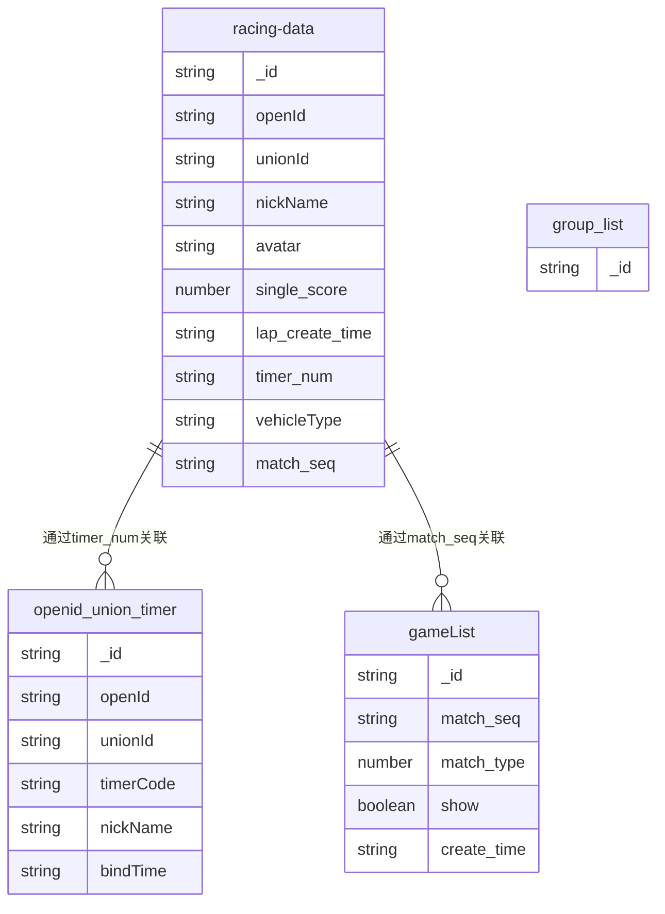

# 胜道赛车计时榜 - MongoDB 数据集合文档

## 概述

本文档详细描述了胜道赛车计时榜项目中使用的所有 MongoDB 数据集合，包括集合用途、字段结构以及相关的云函数操作。

**数据库环境**: `racing-7gxq1capbac7539a`  
**区域**: `ap-shanghai`

---

## 核心业务集合

### 1. racing-data (圈速数据集合)

**用途**: 存储所有用户的圈速记录数据，是系统的核心数据集合。

**字段结构**:
```typescript
interface RacingData {
  _id: string;                    // 文档ID
  openId: string;                 // 微信用户openId
  unionId?: string;               // 微信用户unionId
  nickName: string;               // 用户昵称
  avatar: string;                 // 用户头像文件ID
  single_score: number;           // 圈速时间(毫秒)
  lap_create_time: string;        // 圈速创建时间 "YYYY-MM-DD HH:mm:ss"
  timer_num: string;              // 计时器编号
  carName?: string;               // 车辆名称
  vehicleType: string;            // 车辆类型: 'motorcycle'|'Moto'|'Car'
  displacement?: string;          // 排量
  group?: string;                 // 分组: 'A'|'B'|'C'
  gender?: number;                // 性别: 0|1|2
  match_seq?: string;             // 比赛序号
}
```

**相关云函数操作**:
- **写入操作**:
  - `post_score_fromlocal` - 批量添加圈速数据
  - `batch_update_type` - 批量更新车辆类型
- **读取操作**:
  - `find_my_bestscore` - 查询用户最佳成绩
  - `find_my_bestscore_currentmonth` - 查询用户当月最佳成绩
  - `find_my_history` - 查询用户历史记录
  - `query_realtime_score` - 查询当日实时圈速
  - `query_score_from_match` - 查询比赛成绩
  - `query_total_rank` - 查询总排行榜

---

### 2. openid_union_timer (用户计时器绑定集合)

**用途**: 存储微信用户与计时器设备的绑定关系，每日绑定有效。

**字段结构**:
```typescript
interface TimerBinding {
  _id: string;                    // 文档ID
  openId: string;                 // 微信用户openId
  unionId: string;                // 微信用户unionId
  timerCode: string;              // 计时器编号
  nickName: string;               // 用户昵称
  avatar: string;                 // 用户头像文件ID
  carName: string;                // 车辆名称
  vehicleType: string;            // 车辆类型
  displacement: string;           // 排量
  group: string;                  // 分组
  bindTime: string;               // 绑定时间 "YYYY-MM-DD HH:mm:ss"
}
```

**相关云函数操作**:
- **写入操作**:
  - `bind_wx` - 创建用户与计时器的绑定关系
- **读取操作**:
  - `post_score_fromlocal` - 查询计时器绑定信息以关联用户数据

---

### 3. gameList (比赛列表集合)

**用途**: 存储比赛活动信息和比赛配置。

**字段结构**:
```typescript
interface GameList {
  _id: string;                    // 文档ID
  match_seq: string;              // 比赛序号
  match_type: number;             // 比赛类型: 1-圈速赛, 2-排位赛
  show: boolean;                  // 是否显示
  create_time: string;            // 创建时间
  // 其他比赛相关字段...
}
```

**相关云函数操作**:
- **写入操作**:
  - `post_match_fromlocal` - 添加比赛数据
- **读取操作**:
  - `query_match_list` - 查询比赛列表

---

### 4. group_list (分组列表集合)

**用途**: 存储车手分组信息配置。

**字段结构**:
```typescript
interface GroupList {
  _id: string;                    // 文档ID
  // 分组相关字段...
}
```

**相关云函数操作**:
- **读取操作**:
  - `query_group_list` - 查询分组列表

---

## 扩展系统

### 抽奖系统集合
抽奖系统相关的数据集合已独立维护，详见：[抽奖系统数据集合文档](./LUCKY_SYSTEM_COLLECTIONS.md)

包含以下集合：
- `lucky_activity_list` - 抽奖活动列表
- `lucky_award_config` - 奖品配置集合  
- `lucky_approve_list` - 抽奖审核列表
- `lucky_lottery_record` - 抽奖记录集合

---

## 数据集合关系图



---

## 云函数与数据集合操作映射

### 核心业务云函数

| 云函数名称 | 操作类型 | 涉及集合 | 主要功能 |
|-----------|---------|----------|----------|
| `login` | 读取 | - | 获取微信用户身份信息 |
| `bind_wx` | 写入 | `openid_union_timer` | 绑定用户与计时器 |
| `post_score_fromlocal` | 读取+写入 | `openid_union_timer`, `racing-data` | 赛场本地脚本通过HTTP上传圈速数据 |
| `post_match_fromlocal` | 写入 | `gameList` | 上传比赛数据（后台系统） |
| `batch_update_type` | 更新 | `racing-data` | 批量更新车辆类型（本地测试脚本，订正数据） |
| `find_my_bestscore` | 读取 | `racing-data` | 查询登陆用户最佳成绩 |
| `find_my_bestscore_currentmonth` | 读取 | `racing-data` | 查询登陆用户当月最佳成绩 |
| `find_my_history` | 读取 | `racing-data` | 查询登陆用户历史记录 |
| `query_realtime_score` | 读取 | `racing-data` | 查询当日实时圈速 |
| `query_score_from_match` | 读取 | `racing-data` | 查询比赛成绩 |
| `query_total_rank` | 读取 | `racing-data` | 查询总排行榜 |
| `query_match_list` | 读取 | `gameList` | 查询比赛列表 |
| `query_group_list` | 读取 | `group_list` | 查询分组列表 |

### 抽奖系统云函数
抽奖系统相关的云函数操作映射详见：[抽奖系统数据集合文档](./LUCKY_SYSTEM_COLLECTIONS.md)

---

## 数据兼容性说明

### 车辆类型兼容性
在 `racing-data` 集合中，`vehicleType` 字段存在历史数据兼容性问题：
- `'motorcycle'` 和 `'Moto'` 在业务逻辑中表示同一种车型（摩托车）
- `'Car'` 表示汽车类型
- 相关云函数（如 `query_total_rank`）已实现兼容性处理

### 时间格式标准
- 所有时间字段统一使用格式：`"YYYY-MM-DD HH:mm:ss"`
- 时间戳字段使用 JavaScript 时间戳（毫秒）

### 文件存储
- 图片和文件通过腾讯云存储服务管理
- 数据库中存储文件ID，通过 `cloud.getTempFileURL()` 获取临时访问URL

---

## 索引建议

基于云函数的查询模式，建议为以下字段建立索引：

### racing-data 集合
- `openId` - 用户查询
- `unionId` - 用户查询
- `single_score` - 排行榜查询
- `lap_create_time` - 时间范围查询
- `vehicleType` - 车辆类型筛选
- `match_seq` - 比赛数据查询
- `timer_num` - 计时器数据查询

### openid_union_timer 集合
- `timerCode` + `bindTime` - 计时器绑定查询
- `openId` - 用户绑定查询


---

**文档版本**: 1.0.0  
**更新时间**: 2025-10-09  
**维护人员**: 开发团队
