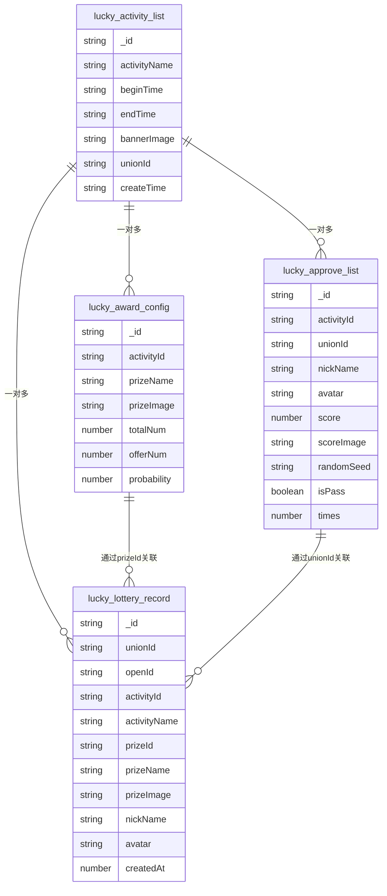
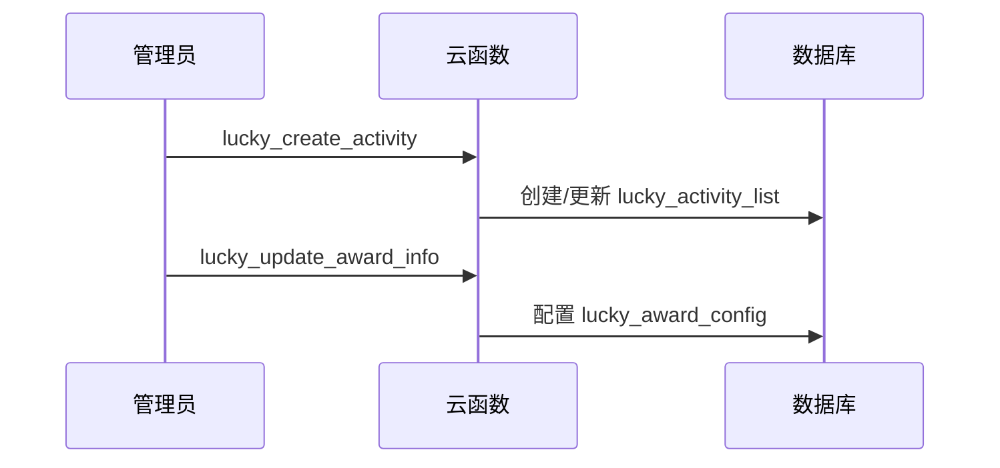
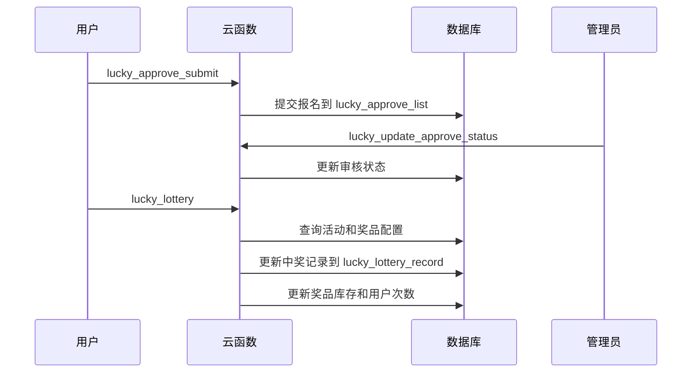

# 胜道赛车计时榜 - 抽奖系统数据集合文档

## 概述

本文档专门描述胜道赛车计时榜项目中抽奖系统相关的 MongoDB 数据集合，包括集合用途、字段结构以及相关的云函数操作。

**数据库环境**: `racing-7gxq1capbac7539a`  
**区域**: `ap-shanghai`

---

## 抽奖系统集合

### 1. lucky_activity_list (抽奖活动列表)

**用途**: 存储抽奖活动的基本信息和配置。

**字段结构**:
```typescript
interface LuckyActivityList {
  _id: string;                    // 文档ID
  activityName: string;           // 活动名称
  beginTime: string;              // 开始时间
  endTime: string;                // 结束时间
  bannerImage?: string;           // 横幅图片文件ID
  unionId: string;                // 创建者unionId
  createTime: string;             // 创建时间 "YYYY-MM-DD HH:mm:ss"
  // 其他活动配置字段...
}
```

**相关云函数操作**:
- **写入操作**:
  - `lucky_create_activity` - 创建或更新抽奖活动
- **读取操作**:
  - `lucky_get_activity_info` - 获取单个活动详情
  - `lucky_get_activity_list` - 获取活动列表
  - `lucky_lottery` - 抽奖时获取活动信息

---

### 2. lucky_award_config (奖品配置集合)

**用途**: 存储抽奖活动的奖品配置信息。

**字段结构**:
```typescript
interface LuckyAwardConfig {
  _id: string;                    // 文档ID
  activityId: string;             // 关联的活动ID
  prizeName: string;              // 奖品名称
  prizeImage?: string;            // 奖品图片文件ID
  totalNum: number;               // 奖品总数量
  offerNum: number;               // 已发放数量
  probability: number;            // 中奖概率
  // 其他奖品配置字段...
}
```

**相关云函数操作**:
- **写入操作**:
  - `lucky_update_award_info` - 创建或更新奖品信息
  - `lucky_delete_award_info` - 删除奖品信息
  - `lucky_lottery` - 抽奖时更新已发放数量
- **读取操作**:
  - `lucky_get_award_info` - 获取活动奖品列表
  - `lucky_lottery` - 抽奖时获取奖品配置

---

### 3. lucky_approve_list (抽奖审核列表)

**用途**: 存储用户的抽奖报名和审核信息。

**字段结构**:
```typescript
interface LuckyApproveList {
  _id: string;                    // 文档ID
  activityId: string;             // 关联的活动ID
  unionId: string;                // 用户unionId
  nickName: string;               // 用户昵称
  avatar?: string;                // 用户头像文件ID
  score: number;                  // 成绩分数
  scoreImage?: string;            // 成绩截图文件ID
  randomSeed: string;             // 随机种子(加密)
  isPass?: boolean;               // 是否审核通过
  times?: number;                 // 剩余抽奖次数
  // 其他审核相关字段...
}
```

**相关云函数操作**:
- **写入操作**:
  - `lucky_approve_submit` - 提交抽奖报名
  - `lucky_update_approve_status` - 更新审核状态
  - `lucky_update_lottery_remaintimes` - 更新剩余抽奖次数
  - `lucky_lottery` - 抽奖时扣减次数
- **读取操作**:
  - `lucky_get_approve_list` - 获取审核列表
  - `lucky_get_lottery_join_info` - 获取用户报名信息
  - `lucky_lottery` - 抽奖时获取用户信息

---

### 4. lucky_lottery_record (抽奖记录集合)

**用途**: 存储用户的中奖记录。

**字段结构**:
```typescript
interface LuckyLotteryRecord {
  _id: string;                    // 文档ID
  unionId: string;                // 用户unionId
  openId: string;                 // 用户openId
  activityId: string;             // 关联的活动ID
  activityName: string;           // 活动名称
  prizeId: string;                // 奖品ID
  prizeName: string;              // 奖品名称
  prizeImage?: string;            // 奖品图片文件ID
  nickName: string;               // 用户昵称
  avatar?: string;                // 用户头像文件ID
  createdAt: number;              // 中奖时间戳
}
```

**相关云函数操作**:
- **写入操作**:
  - `lucky_lottery` - 中奖时创建记录
- **读取操作**:
  - `lucky_get_activity_lottery_record` - 获取活动中奖记录
  - `lucky_get_my_lottery_record` - 获取用户中奖记录

---

## 抽奖系统数据关系图



---

## 抽奖系统云函数操作映射

| 云函数名称 | 操作类型 | 涉及集合 | 主要功能 |
|-----------|---------|----------|----------|
| `lucky_is_admin_user` | 读取 | - | 验证管理员权限 |
| `lucky_create_activity` | 写入+更新 | `lucky_activity_list` | 创建/更新抽奖活动 |
| `lucky_get_activity_list` | 读取 | `lucky_activity_list` | 获取活动列表 |
| `lucky_get_activity_info` | 读取 | `lucky_activity_list` | 获取活动详情 |
| `lucky_update_award_info` | 写入+更新 | `lucky_award_config` | 创建/更新奖品配置 |
| `lucky_get_award_info` | 读取 | `lucky_award_config` | 获取奖品列表 |
| `lucky_delete_award_info` | 删除 | `lucky_award_config` | 删除奖品配置 |
| `lucky_approve_submit` | 写入+更新 | `lucky_approve_list` | 提交抽奖报名 |
| `lucky_get_approve_list` | 读取 | `lucky_approve_list` | 获取审核列表 |
| `lucky_get_lottery_join_info` | 读取 | `lucky_approve_list` | 获取用户报名信息 |
| `lucky_update_approve_status` | 更新 | `lucky_approve_list` | 更新审核状态 |
| `lucky_update_lottery_remaintimes` | 更新 | `lucky_approve_list` | 更新剩余抽奖次数 |
| `lucky_lottery` | 读取+写入+更新 | `lucky_activity_list`, `lucky_award_config`, `lucky_approve_list`, `lucky_lottery_record` | 执行抽奖逻辑 |
| `lucky_get_activity_lottery_record` | 读取 | `lucky_lottery_record` | 获取活动中奖记录 |
| `lucky_get_my_lottery_record` | 读取 | `lucky_lottery_record` | 获取用户中奖记录 |

---

## 抽奖系统业务流程

### 抽奖活动创建流程


### 用户参与抽奖流程


---

## 抽奖系统特性说明

### 随机种子机制
- 用户提交报名时包含加密的随机种子 (`randomSeed`)
- 通过自定义加密算法确保抽奖的公平性
- 管理员可以验证抽奖结果的真实性

### 概率控制
- 每个奖品配置独立的中奖概率 (`probability`)
- 支持动态库存管理 (`totalNum` vs `offerNum`)
- 自动计算未中奖概率，确保概率总和合理

### 审核机制
- 用户需要提交成绩截图等材料
- 管理员审核通过后才能获得抽奖资格
- 支持设置用户的抽奖次数限制

### 事务安全
- 抽奖过程使用数据库事务确保数据一致性
- 防止超发奖品和重复中奖
- 异常情况下自动回滚

---

## 索引建议

基于抽奖系统的查询模式，建议为以下字段建立索引：

### lucky_activity_list 集合
- `createTime` - 活动列表排序
- `beginTime` + `endTime` - 活动时间范围查询

### lucky_award_config 集合
- `activityId` - 按活动查询奖品
- `totalNum` + `offerNum` - 库存查询

### lucky_approve_list 集合
- `activityId` + `unionId` - 用户报名查询
- `activityId` + `isPass` - 审核列表查询
- `score` - 成绩排序

### lucky_lottery_record 集合
- `activityId` - 活动中奖记录
- `unionId` - 用户中奖记录
- `createdAt` - 中奖时间排序

---

## 数据安全建议

### 敏感信息保护
- 随机种子使用自定义加密算法
- 用户头像和截图通过云存储管理
- 管理员权限通过 unionId 白名单控制

### 防作弊机制
- 限制用户抽奖次数
- 审核机制防止虚假成绩
- 事务机制防止并发问题

### 数据备份
- 定期备份中奖记录
- 保留审核材料的历史版本
- 监控异常的抽奖行为

---

**文档版本**: 1.0.0  
**更新时间**: 2025-10-09  
**维护人员**: 开发团队
