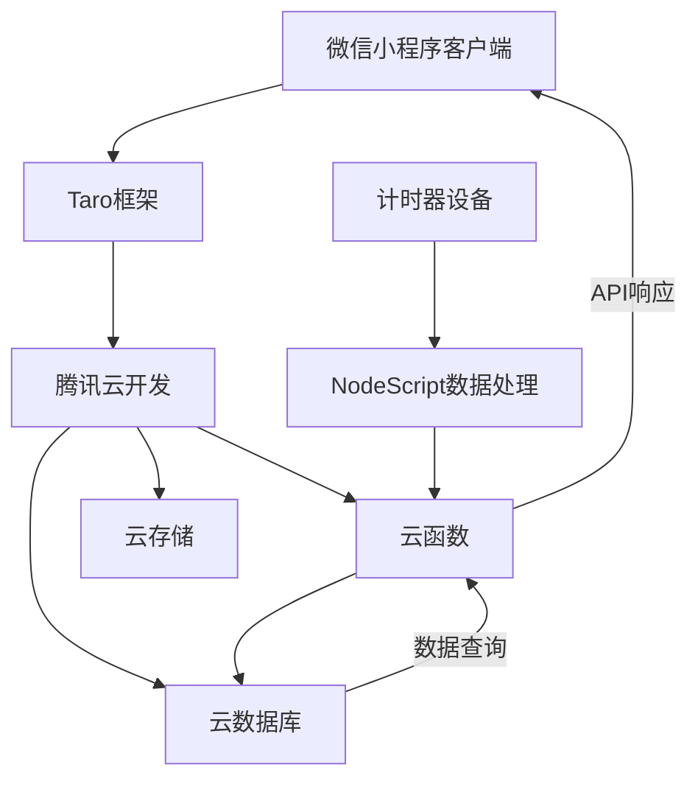
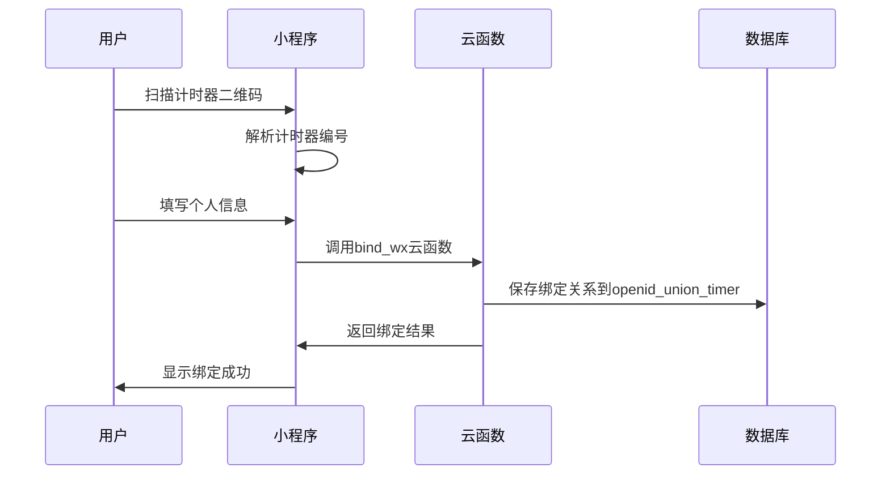
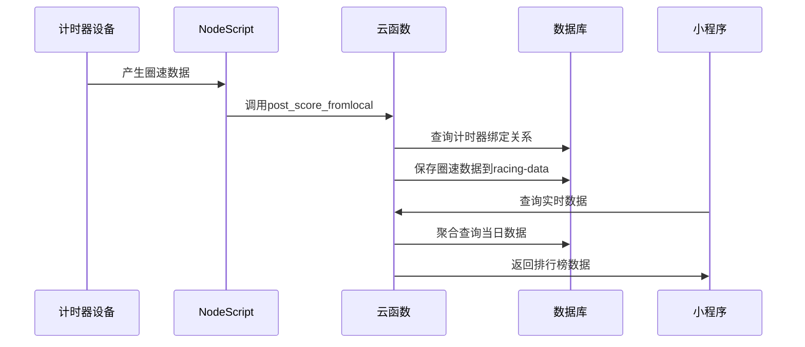

# 胜道赛车计时榜项目规范

## 项目概述

### 业务背景
胜道赛车计时榜是一个基于微信小程序的摩托车赛道计时系统，主要服务于赛车场的圈速记录、排行榜展示和用户管理。系统通过计时器设备采集圈速数据，用户通过扫码绑定计时器与微信身份的关联关系，实现个人成绩追踪和排行榜功能。

### 核心功能模块
1. **实时圈速数据** - 当天赛车手在赛场的实时圈速数据展示
2. **微信扫码绑定** - 绑定计时器和微信用户的关系，建立身份关联
3. **历史总榜** - 赛道内所有车手的历史最佳成绩排行榜
4. **个人中心** - 用户个人历史圈速成绩和赛道相关功能

## 技术架构

### 整体架构


### 技术栈

#### 前端技术栈
- **框架**: Taro 3.6.25 (React 18)
- **UI组件库**: NutUI React Taro 2.5.2
- **样式**: Less
- **状态管理**: React Hooks
- **构建工具**: Webpack 5
- **开发语言**: TypeScript

#### 后端技术栈
- **云平台**: 腾讯云开发 (CloudBase)
- **云函数**: Node.js
- **数据库**: 腾讯云数据库 (MongoDB)
- **文件存储**: 腾讯云存储
- **环境**: racing-7gxq1capbac7539a

#### 数据处理
- **Node.js脚本**: 处理计时器设备数据
- **数据同步**: 实时数据上传和处理

## 项目结构

### 目录结构
```
shengdao-racing/
├── client/                 # 微信小程序前端代码
│   ├── src/
│   │   ├── pages/         # 页面组件
│   │   ├── components/    # 公共组件
│   │   ├── utils/         # 工具函数
│   │   ├── constant/      # 常量定义
│   │   ├── type/          # TypeScript类型定义
│   │   └── assets/        # 静态资源
│   └── dist/              # 构建输出目录
├── cloud/                 # 腾讯云函数
│   └── functions/         # 云函数目录
└── nodeScript/            # 数据处理脚本
```

### 页面结构
- **pages/index** - 圈速数据（实时榜单）
- **pages/match** - 比赛模块
- **pages/rank** - 排行榜（历史总榜）
- **pages/my** - 个人中心
- **pages/scanQRCode** - 扫码页面
- **pages/bindWXTimer** - 绑定计时器页面
- **pages/history** - 历史记录
- **pages/track** - 赛道介绍
- **pages/activity** - 赛道活动
- **pages/shop** - 装备周边

## 数据模型

### 核心数据集合

#### 1. racing-data (圈速数据)
```typescript
interface RacingData {
  _id: string;
  openId: string;           // 微信openId
  unionId?: string;         // 微信unionId
  nickName: string;         // 用户昵称
  avatar: string;           // 头像文件ID
  single_score: number;     // 圈速时间(毫秒)
  lap_create_time: string;  // 圈速创建时间
  timer_num: string;        // 计时器编号
  carName?: string;         // 车辆名称
  vehicleType: 'motorcycle' | 'Moto' | 'Car'; // 车辆类型
  displacement?: string;    // 排量
  group?: 'A' | 'B' | 'C'; // 分组
  gender?: 0 | 1 | 2;      // 性别
  match_seq?: string;       // 比赛序号
}
```

#### 2. openid_union_timer (用户计时器绑定)
```typescript
interface TimerBinding {
  _id: string;
  openId: string;
  unionId: string;
  timerCode: string;        // 计时器编号
  nickName: string;
  avatar: string;
  carName: string;
  vehicleType: string;
  displacement: string;
  group: string;
  bindTime: string;         // 绑定时间
}
```

#### 3. gameList (比赛列表)
```typescript
interface GameList {
  _id: string;
  match_seq: string;        // 比赛序号
  match_type: 1 | 2;       // 比赛类型：1-圈速赛，2-排位赛
  // 其他比赛相关字段
}
```

### 数据类型定义

#### 车辆类型兼容性
- `'motorcycle'` 和 `'Moto'` 在业务逻辑中视为同一类型（摩托车）
- `'Car'` 为汽车类型
- 查询时需要使用兼容性处理

#### 分组类型
- A组、B组、C组按技能水平划分

#### 排量规格
- 支持：150, 250, 300, 400, 450, 500, 600, 650, 800, 900, 1000cc

## 开发规范

### 代码规范

#### 1. 命名规范
- **文件命名**: 使用 kebab-case (如: `bind-wx-timer`)
- **组件命名**: 使用 PascalCase (如: `BindWXTimer`)
- **函数命名**: 使用 camelCase (如: `getOpenId`)
- **常量命名**: 使用 UPPER_SNAKE_CASE (如: `DEFAULT_GROUP`)

#### 2. TypeScript规范
- 所有组件必须使用TypeScript
- 定义明确的接口类型
- 避免使用 `any` 类型
- 使用严格的类型检查

#### 3. 云函数规范
- 统一错误处理机制
- 使用 `throwOnNotFound: false` 避免查询异常
- 参数验证和默认值处理
- 兼容性处理（如vehicleType的兼容）

### 云函数开发规范

#### 1. 初始化模板
```javascript
const tcb = require('@cloudbase/node-sdk')
const cloud = require('wx-server-sdk')

const tcbapp = tcb.init({
    env: 'racing-7gxq1capbac7539a',
    region: "ap-shanghai",
});

cloud.init({
  env: 'racing-7gxq1capbac7539a'
})

const db = tcbapp.database({ throwOnNotFound: false })
const _ = db.command;

exports.main = async (event, context) => {
    try {
        // 业务逻辑
    } catch (error) {
        console.error(error);
        return { code: -1, message: error.message };
    }
}
```

#### 2. 数据查询规范
- 使用聚合查询优化性能
- 限制查询结果数量 (limit)
- 合理使用索引
- 处理数据兼容性问题

#### 3. 用户身份验证
```javascript
// 获取微信上下文
const wxContext = cloud.getWXContext();
const openId = wxContext.OPENID;
const unionId = wxContext.UNIONID || wxContext.FROM_UNIONID;

// 多条件查询用户数据
const conditions = [];
if (openId) conditions.push({ openId });
if (unionId) conditions.push({ unionId });
const userQuery = _.or(conditions);
```

### 前端开发规范

#### 1. 组件结构
```typescript
import { useEffect, useState } from 'react'
import Taro from '@tarojs/taro'
import { View } from '@tarojs/components'
import './index.less'

interface Props {
  // 定义组件属性
}

export default function ComponentName(props: Props) {
  // 状态管理
  const [state, setState] = useState();
  
  // 生命周期
  useEffect(() => {
    // 初始化逻辑
  }, []);
  
  // 事件处理
  const handleEvent = () => {
    // 事件逻辑
  };
  
  return (
    <View className='component-name'>
      {/* JSX内容 */}
    </View>
  );
}
```

#### 2. 云函数调用规范
```typescript
// 统一的云函数调用方式
const callCloudFunction = async (name: string, data?: any) => {
  try {
    Taro.showLoading();
    const res = await Taro.cloud.callFunction({ name, data });
    return res.result;
  } catch (error) {
    console.error(`云函数${name}调用失败:`, error);
    Taro.showToast({ title: '网络错误', icon: 'error' });
  } finally {
    Taro.hideLoading();
  }
};
```

#### 3. 用户身份管理
```typescript
// 统一的用户身份获取
import { getOpenId } from '../utils';

const getUserInfo = async () => {
  const { openId, unionId } = await getOpenId();
  // 使用用户信息
};
```

### 样式规范

#### 1. Less规范
- 使用嵌套结构
- 定义统一的颜色变量
- 响应式设计考虑

#### 2. 主题色彩
- 主色调: `#f53d4d` (红色)
- 背景色: `#1f232d` (深灰)
- 文字色: `#fff` (白色)

### 数据处理规范

#### 1. 时间格式化
```typescript
// 统一的时间格式化函数
export function formatMilliseconds(milliseconds: number): string {
  const hours = Math.floor(milliseconds / 3600000);
  const minutes = Math.floor((milliseconds % 3600000) / 60000);
  const seconds = Math.floor((milliseconds % 60000) / 1000);
  const remainingMs = milliseconds % 1000;
  
  let result = '';
  if (hours > 0) result += `${hours}h`;
  if (minutes > 0) result += `${minutes}'`;
  result += `${seconds}.${remainingMs.toString().padStart(3, '0')}`;
  
  return result;
}
```

#### 2. 数据兼容性处理
```javascript
// 车辆类型兼容性处理
const getCompatibleVehicleTypes = (type) => {
  if (type === 'motorcycle' || type === 'Moto') {
    return ['motorcycle', 'Moto'];
  }
  return [type];
};
```

## 业务流程

### 用户绑定流程


### 圈速数据流程


## 部署和运维

### 环境配置
- **云开发环境**: racing-7gxq1capbac7539a
- **地域**: ap-shanghai (上海)
- **小程序AppID**: 需要配置对应的微信小程序

### 构建部署
```bash
# 开发环境
npm run dev:weapp

# 生产构建
npm run build:weapp
```

### 云函数部署
- 使用微信开发者工具或CLI工具部署
- 确保云函数权限配置正确
- 定期检查云函数日志

## 性能优化

### 数据库优化
- 为常用查询字段建立索引 (openId, single_score, vehicleType)
- 使用聚合查询减少数据传输
- 合理设置查询限制 (limit)

### 前端优化
- 图片资源优化和懒加载
- 合理使用缓存机制
- 避免频繁的云函数调用

### 云函数优化
- 复用数据库连接
- 批量处理数据操作
- 合理的错误处理和重试机制

## 安全规范

### 数据安全
- 用户敏感信息加密存储
- 云函数权限最小化原则
- 定期备份重要数据

### 接口安全
- 云函数参数验证
- 防止SQL注入和XSS攻击
- 合理的访问频率限制

## 测试规范

### 单元测试
- 核心业务逻辑测试
- 数据处理函数测试
- 云函数接口测试

### 集成测试
- 完整业务流程测试
- 数据一致性测试
- 性能压力测试

## 文档维护

### 代码文档
- 关键函数添加注释
- 复杂业务逻辑说明
- API接口文档

### 变更记录
- 版本更新日志
- 数据库结构变更
- 业务逻辑调整记录

---

**版本**: 1.0.0  
**更新时间**: 2025-10-09  
**维护人员**: 开发团队
